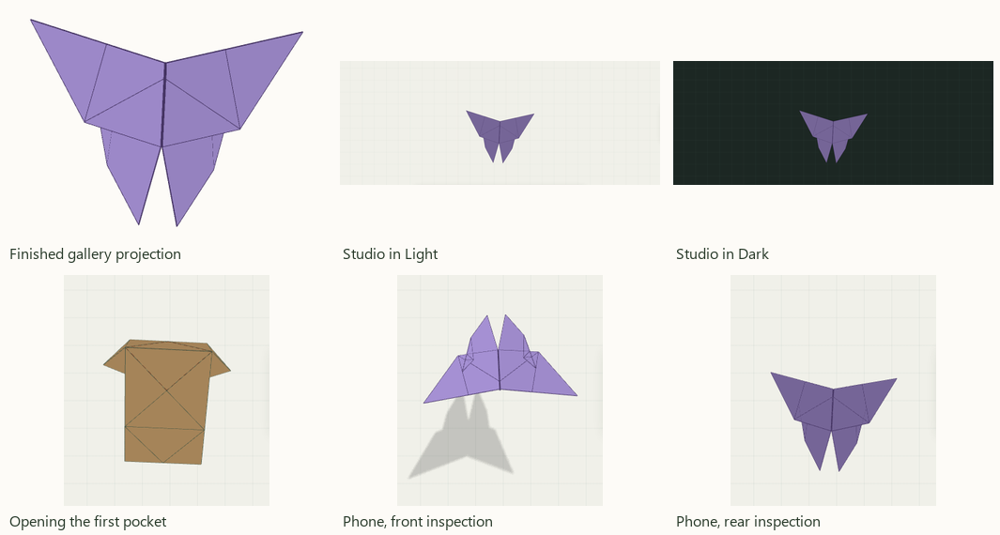

# Oripo

Oripo is a multilingual 3D origami lesson player. Scrub to the middle of a fold, orbit behind the sheet to see which layers move, then reverse to the crease that formed them. Each lesson also includes complete written instructions in static HTML, with an expected result for every action.



The gallery projection and production browser captures show the same Monarch mesh. The narrow views use a simulated phone viewport.

| Maker tier   | Lessons in the gallery                       |
| ------------ | -------------------------------------------- |
| Beginner     | Dart paper airplane · Paper heart · Fox face |
| Intermediate | Masu box · Jumping frog · Monarch butterfly  |
| Advanced     | Pinwheel calyx · River tern · Amber hex iris |

The nine lessons contain 126 actions in English, Persian, Spanish, French, Simplified Chinese, Arabic, Brazilian Portuguese, German, Japanese and Hindi. Human translation review, physical folding trials and independent difficulty ratings remain open.

## Run locally

Use Node **22.23.2** and npm **10.9.8**. From the checkout you intend to view, run the following commands. On Windows, `npm.cmd` works in PowerShell and Git Bash.

```sh
npm ci --strict-peer-deps
npm run dev
```

Open the address Vite prints (normally port 5173). Visit `/en#models` for the gallery or `/en/lessons/monarch-butterfly` for the butterfly. For a production preview, stop dev with Ctrl+C, then run `npm run build` followed by `npm run preview`. Open `http://127.0.0.1:4173/en#models` and keep that terminal running. Each worktree has its own build. [Worktree and lock troubleshooting](docs/release.md)

## How a fold reaches the screen

The TypeScript compiler turns a lesson's welded sheet, signed hinges and coupled motions into exact step endpoints and functions of fold progress. Drawing adds a thin offset between touching plies. Three.js and React Three Fiber display the material pose and drawing layers. React Router Framework Mode and Vite prerender each localized transcript and load the interactive scene and selected model on demand. Tailwind and daisyUI supply the light and dark themes. [Architecture and source map](docs/architecture.md)

A contributor starts with a specific paper design, its rights and an independently checked fold sequence. `npm run models -- new my-fold` creates a working draft. Edit its package, validate the folds, prepare the ten manuscripts and inspect its finished projection in the studio. Supported motion includes rigid turns, constrained pockets, spatial crimps and one six-sector twist family. Continuous curls and arbitrary crease-pattern animation require additional geometry. [Authoring contract and examples](docs/authoring.md) · [AI-assisted development and review](docs/ai-development.md)

## Verify changes

```sh
npm run typecheck
npm run lint
npm run format:check
npm run models -- check
npm test
npm run build
npx playwright install --only-shell chromium firefox webkit
npm run test:smoke
```

Install the browsers once for the locked Playwright version. On a minimal Linux runner add `--with-deps`. The smoke suite serves `build/client` on disposable loopback ports. Use `npm run test:smoke -- --project=firefox` to investigate a single browser. Run `node scripts/measure.mjs` after building to measure cold script, scene, model and font requests. [Local evidence and release checklist](docs/release.md) · [Contributing](CONTRIBUTING.md) · [Reporting a security concern](SECURITY.md)

## License and credits

Original code is MIT-licensed. The Oripo mark, crane illustration, lesson geometry and generated previews are project assets. Each model identifies its construction and rights. The six self-hosted font subsets retain their SIL Open Font Licenses. The static build includes `third-party-licenses.txt` and `additional-notices.txt`. [MIT license](LICENSE) · [Font sources and licenses](docs/fonts.md) · [Additional notices](public/additional-notices.txt)
